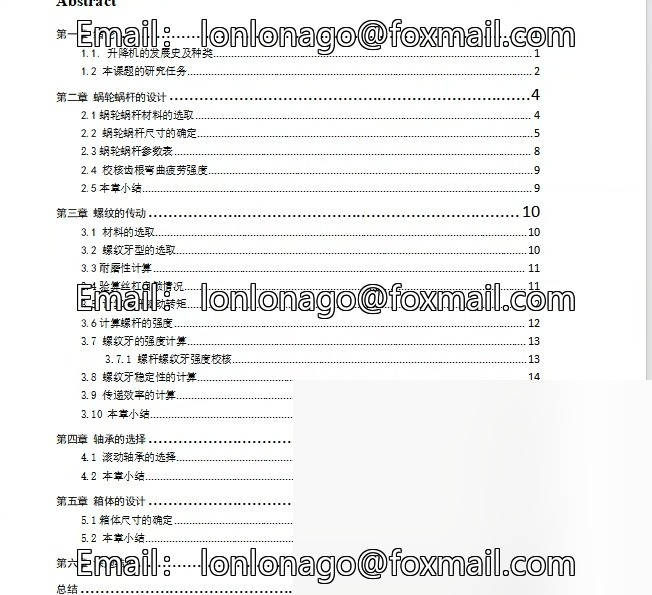
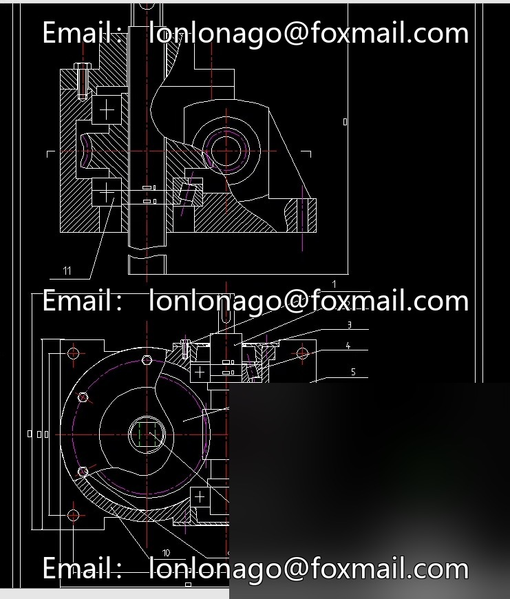
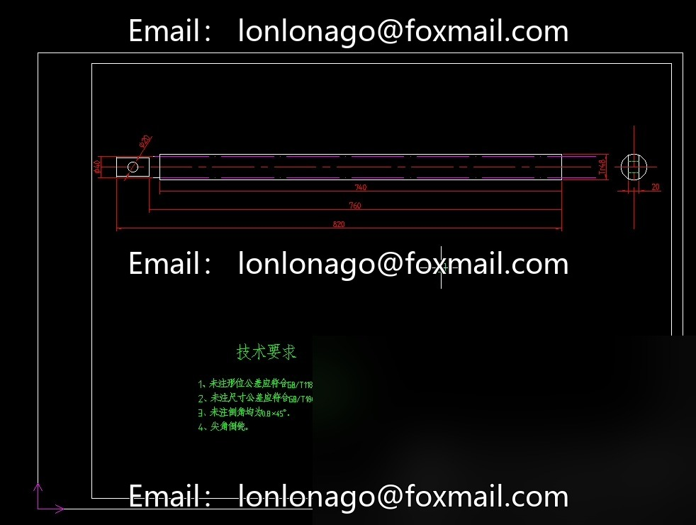
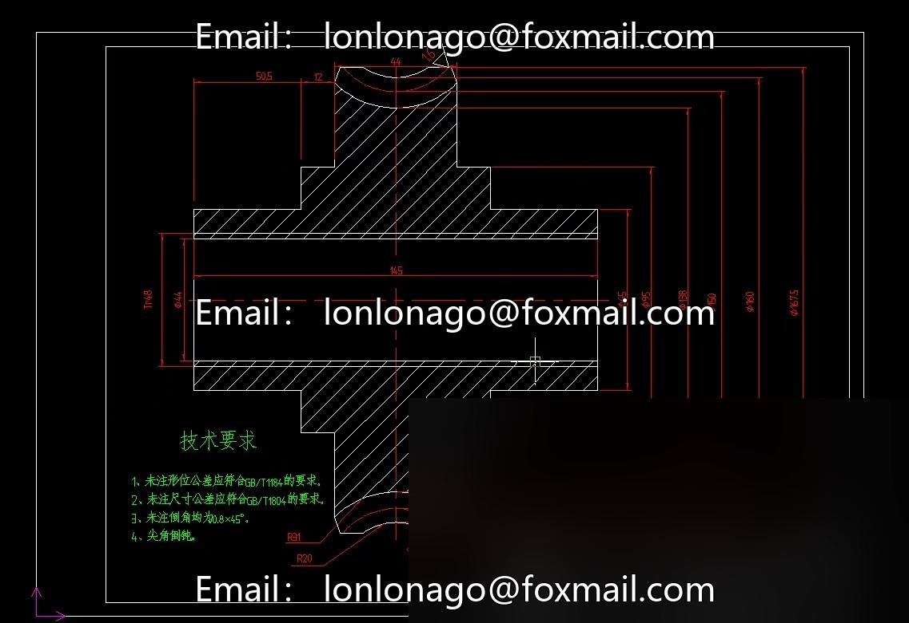

# Manual worm gear screw lifting machine design manual worm gear screw lifting machine design diagram manual worm gear screw

## Body

Manual worm gear screw rise mechanism design; manual worm gear screw rise mechanism design diagram; manual worm gear screw rise mechanism design CAD diagram
Two sets of similar designs
66 - includes assembly drawings, parts drawings, and design descriptions

The design covers manual worm-gear hanger design, design drawings, CAD drawings, two similar designs, and sections on material selection, dimension determination, strength verification, and technical requirements.

<!-- AI_ENRICHED -->

## Images

## Payment

Here is a pay link on Stripe ( https://buy.stripe.com/3cs8yP7sY87d0vu9AB ). Please contact me lonlonago@foxmail.com after funding $89, and I will send you a complete data files , thank you!

